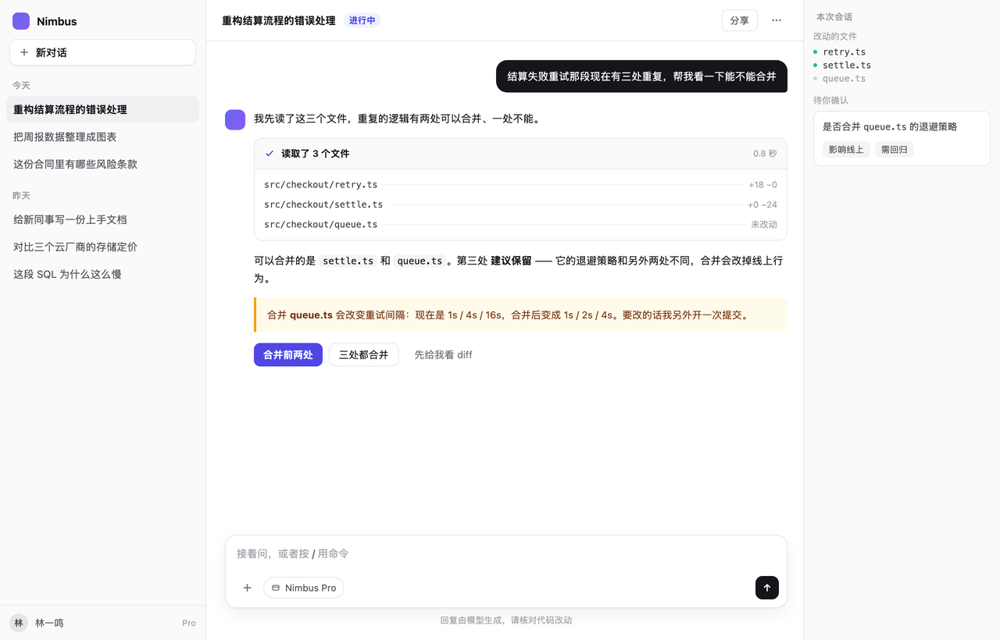
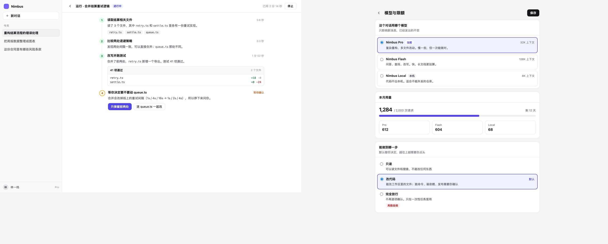
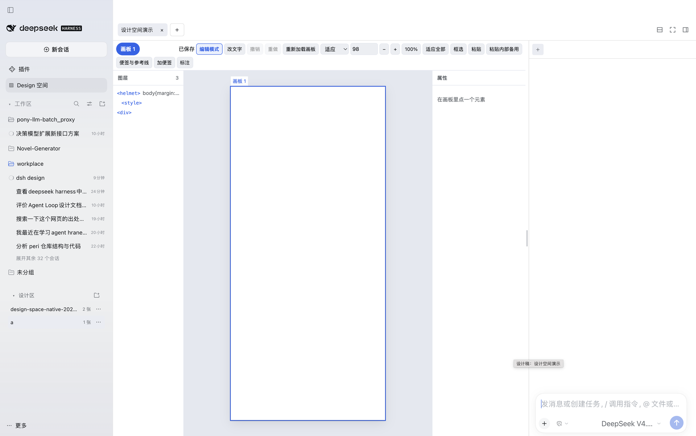

# dsh-plugin-design

**DeepSeek Harness 的插件**：让 agent 在你的工作目录里做设计 —— 界面、网页、海报、印刷品、图表、App 交互流程，还能装一套自己的设计系统。

做完的设计稿**能校验、能渲染出图给你看、能导出成双击就打开的网页**；你还想自己动手调，有 **Design 空间**——在 Harness 主区域里编辑，旁边就是与 AI 的对话。



<sub>上图是这个插件做出来的 AI 助手界面，源码在 [examples/ai-assistant](examples/ai-assistant) —— 三块画板：对话、运行过程、模型与限额。</sub>

---

## 目录

- [快速开始](#快速开始)
- [这是一个 DSH 插件](#这是一个-dsh-插件)
- [能做什么](#能做什么)
- [用起来](#用起来)
- [快捷键](#快捷键)
- [需要知道的事](#需要知道的事)
- [开发](#开发)
- [来源与依赖](#来源与依赖)

---

## 快速开始

前置：**Node ≥ 20**、**npm**、**Chrome / Chromium / Edge**（只有渲染出图需要它）。构建依赖由 `install.sh` 自动装。

```sh
git clone <this repo> && cd dsh-plugin-design
./install.sh                      # 默认装进 desktop profile
./install.sh --profile web        # 或别的 profile
```

`install.sh` 做三件事：构建插件、把两个 skill 装进 `<dsh home>/skills/`、把插件装进 profile。

然后**完全退出并重启 DSH**。skill 是热加载的（重启前就生效），插件要重新加载一次。

试一句：

```
做一版 AI 助手的对话界面，桌面端，左边会话列表右边对话
```

### 怎么配合

1. 先说清楚要什么（做什么、给谁看、多大尺寸）
2. agent 做完会**自己渲一张图贴出来**
3. 你就着那张图提意见 —— 「标题再大」「太挤了」「换个方向」
4. 想自己微调就打开编辑器，改完告诉 agent 继续

---

## 这是一个 DSH 插件

它不是独立应用，是 **DeepSeek Harness** 的一个插件。装上并重启之后，Harness 里会多出这些：

| 位置 | 多出来的东西 |
|---|---|
| **主区域** | **Design 空间**面板：左边设计目录、中间画布、右边与 AI 的对话 |
| **左侧栏** | **设计区**一节，和工作区并排，可以添加/收起设计目录 |
| **右侧栏** | 设计稿编辑器标签页 |
| **给 agent** | 七个 `design_*` 工具 + 两个 skill |

换句话说：**它是一个让 Harness 里的 agent 去画界面、并且你就在同一个窗口里看着改的工具** —— 不用切到别的设计软件，也不用把图导来导去。下面按使用顺序讲每个功能怎么用。

---

## 能做什么

### 七个工具

| 工具 | 做什么 |
|---|---|
| `design_check` | 校验设计稿格式，逐条列出问题 |
| `design_render` | **画出图来**：每块画板一张 PNG，直接显示在会话里 |
| `design_export` | 导出**自包含 HTML**：一个文件双击就开，能滚动缩放、能发给别人 |
| `design_editor` | 打开**可视化编辑器**，自己点选元素动手改 |
| `design_import_asset` | 把图片、字体导入设计稿 |
| `design_system_check` | 校验设计系统 |
| `design_system_import_asset` | 把图片、视频、PDF、字体导入设计系统 |

校验和导入不需要浏览器，很快；渲染会起一次无头 Chrome，一张静态画板约 5 秒。

### 两个 skill

| Skill | 什么时候命中 |
|---|---|
| `design` | 「做一版……界面 / 网页 / 海报 / 图表 / 示意图 / 原型」 |
| `design-system` | 「把品牌色、字阶、间距整理成设计系统」 |

自动路由，不用点名。

`design` 除了文件协议，还带四份**怎么做才好看**的参考，按任务类型读：**界面基本功**（层级、字号阶梯、间距刻度、颜色、状态、可点击区域）、**印刷品**（纸张尺寸、安全边距、正文下限、信息密度）、**图表与示意图**（图型选择、节点与连线、数据真实性）、**品牌色与字体**（怎么定中性阶、验对比度、选字阶模数）。

`design-system` 管 tokens、素材与布局。细节见 [skills/README.md](skills/README.md)。

### 五份可跑的示例

[`examples/`](examples) 里是五份完整设计稿，clone 下来就能校验、能渲染、能打开编辑器改：

| 目录 | 是什么 |
|---|---|
| [`ai-assistant/`](examples/ai-assistant) | **AI 助手界面**：对话、运行过程、模型与限额。桌面端 1280×820 |
| [`order-flow/`](examples/order-flow) | 四屏 App 点单流程，可点、可跳转 |
| [`ethiopia-guji/`](examples/ethiopia-guji) | A4 印刷海报 |
| [`spring-menu/`](examples/spring-menu) | 菜单海报，带位图素材 |
| [`ember-ds/`](examples/ember-ds) | 一套设计系统：明暗两套主题、11 个颜色、6 种文字样式、间距/圆角/阴影 + 品牌手册 |



---

## 用起来



<sub>就是这张图从左到右的顺序：<b>左侧栏</b>（工作区 + 设计区）、<b>主区域</b>（页签栏 → 工具栏 → 图层｜画布｜属性）、<b>右侧</b>这段设计稿绑定的对话。</sub>

### 1. 设计区目录

设计区固定读取 `~/.design`。每个直接子文件夹对应一份设计稿；隐藏文件夹和符号链接不进入列表。插件每 1.5 秒重新读取目录，窗口重新聚焦时也会刷新。

侧栏的「设计区」与上方工作区标题对齐。两个区域分别收起、展开，状态刷新后保留。

### 2. 新建、重命名与归档

1. 点击「设计区」右侧或页签栏的 `＋`。插件立即创建 `~/.design/未命名设计稿/` 并打开空白画板；重名时自动追加数字。
2. 悬停或聚焦设计稿行，点击「重命名」。原名称变为输入框，按 Enter 或移开焦点保存，按 Escape 取消。侧栏名称、文件夹名和页签名称保持一致。
3. 点击「归档」。设计稿从列表和已打开页签中隐藏，设计文件、对话关联和对话记录副本继续保留在原文件夹。
4. 在设计稿右侧点击「连接对话」，选择新对话或设计区已有对话。新对话直接以 `~/.design` 为工作目录，无需注册宿主工作区，也不自动发送消息。

首轮消息触发 DSH 原有的模型命名流程。对话页签及「连接旧对话」列表读取宿主标题；没有标题时显示未命名状态，不显示 session 标识。

设计文件位于各自的文件夹中。`.dsh/design-tabs.json` 保存会话关联，`.dsh/conversations/` 保存宿主事件日志的 JSON 副本。宿主继续负责实际对话、草稿和附件；副本用于保留记录，不能独立恢复宿主会话。详见 [Design 空间](docs/design-space.md)。

### 3. 页签

一个页签 = 一份设计稿。

- 拖动调整顺序；聚焦后 `Alt + ←/→` 也能移动，普通方向键切换
- 同一份设计稿不会开出两个页签（文件夹重命名后仍保持同一身份），最多同时开 30 份
- 关页签**只关界面**：不停止正在跑的任务，不删设计文件，不删关联的会话

### 4. 改画布

| 想做的 | 怎么做 |
|---|---|
| **改样式** | 点选画板上的元素，或点图层树里的节点，在「属性」面板改 |
| **改文字** | 工具栏「改文字」，或双击元素原地编辑。Esc 或点别处提交 |
| **撤销／重做** | 工具栏按钮或 `Ctrl/Cmd+Z`、`Ctrl/Cmd+Shift+Z`。按**整份设计稿**记录，切画板不清空；跨画板撤销会告诉你影响了哪块 |
| **移动画布** | 空格＋拖动，或鼠标中键拖动，滚轮平移；`Ctrl/Cmd+滚轮` 缩放 |
| **缩放** | 工具栏可输入比例、恢复 100%、或「适应全部」。页面选择器按组显示 |
| **改结构** | 单选后删除、复制副本、插入文字／矩形／素材图片／分隔线；上下移动、移入移出、Flex/Grid 包裹。需要确认的先给预览 |
| **多选批量改** | 修饰键点选、图层范围选择，或工具栏「框选」。属性面板显示共同值／多个值；**一次保存 = 一次撤销**。满足布局条件的选区可整组拖动 |
| **复制粘贴** | 「复制源码」「剪切」「粘贴」，支持同画板和经过依赖检查的跨画板／跨设计稿；「粘贴内部备用」明确用编辑器之前存下的片段 |
| **写便签／拉参考线** | 「加便签」「加分组标题」「便签与参考线」。便签可拖动、改尺寸、改字和样式；当前画板可设分栏、分行或网格 |

多画板画布按视野加载预览，最多同时保留 4 个画板 iframe；当前画板承担编辑交互，点别的画板就切过去。

便签、分组标题、参考线与标注轮廓属于**编辑辅助层**：不写进画板源码，不进浏览模式、渲染图或导出成品。分组标题只用于同一页面的多块画板；每块画板最多 6 条参考线；便签和用户图形合计最多 200。已有图形和未知索引字段会被保留，改便签不会重写它们。

### 5. 标注，然后让 AI 接着改

1. 选中元素或框选一块区域，写批注。编号和轮廓帮你核对目标；循环实例会同时标出对应的模板范围
2. 点「标注」复制标注块，或在 Harness 里选择**插入当前会话草稿**——插入会保留已有草稿，**不会自动发送**
3. 自己检查草稿后发送。如果源码版本变了导致标注过期，**重新选目标**，不要按旧编号改

标注块用 `<dsh-design-annotations>`。历史会话里的 `<baocut-design-annotations>` 结构相同、照常解析——那只是旧的文本协议名，不代表软件依赖。文件标识是 opaque token，不能反解成路径；源文摘录只是帮你认出元素，**不是指令**。详见 [标注与目标定位](skills/design/references/view-state.md)。

### 6. 和 AI 对话

对话在画布**右侧**，左右拖分隔条调宽度（聚焦分隔条后按方向键也行）。

- 右上角三个图标：**分栏**（上下两个不同会话）、**全屏**、**收起/打开对话侧栏**
- 对话栏的 `＋` 给当前设计稿**新建一段独立会话**，不自动发消息；两段会话共用同一份设计文件，各自保留消息、草稿和附件
- 悬停会话页签出现 `×`，点击按工作区语义**归档会话**（能从宿主的已归档列表恢复），设计文件不受影响
- 想回到完整对话就点「在普通对话打开」

**一个会话永远只有一个输入框**：只挂载当前显示的画布，分栏时挂载两个不同会话，后台页签不挂载隐藏输入框。

### 7. 保存、外部修改与历史

- **保存**会先读版本，服务重读盘比对，在临时副本上校验候选结果，再提交。版本冲突直接拒绝
- Agent 或别的程序改了文件 → 画布刷新，**旧标注的位置会失效**；你有没保存的输入时先保留输入并提示
- 历史按**设计稿**记录，一次操作可含多个文件，最多 100 次／单份 64 MiB。保存在服务内存里，**重启 Harness 不保留**
- 服务内的串行锁锁不住别的程序。版本检查能拒绝已发现的外部修改，但**不等于跨程序原子事务**

### 三个入口，同一个编辑器

| 入口 | 什么时候用 |
|---|---|
| **Design 空间**（主区域） | 主推。地方大，且和它的对话在一起 |
| **右侧栏标签页** | 想一边看对话一边改，或主区域正忙着。展开右侧边栏 →「新标签页」→「设计稿编辑器」，它会自动连上当前会话的工作目录 |
| **独立地址** | 指定目录单开，浏览器里用：`design_editor examples/order-flow` |

### 当前边界

- 侧栏的「设计区」标题是**对宿主侧栏 DOM 加受控标记**实现的（宿主还没给区块标题的扩展位）。结构不匹配时退回原工作区布局，设计区仍能独立收起。**升级 Harness 后需要复核这一层兼容**
- 外部修改靠**每 1.5 秒轮询内容版本**核对，不是文件系统原生监听；只在有 SSE 连接时进行
- 页面内最多同时跑 4 个缩略预览；扫描最多递归 4 层、访问 800 个目录、返回 60 份设计稿
- 无法确认来源的导入组件内部元素**不可写**。元素编号只对相应文件的当前版本有效
- `{{…}}` 绑定文字不能原地改；循环模板的样式或结构修改影响全部实例，重复模板实例暂不支持整组拖动
- 结构移动会检查父子关系与绑定作用域，含定位／变换／层叠上下文等无法安全处理的包裹会被拒绝
- 源码剪贴板一次一个子树，不接受任意外部 HTML；跨画板粘贴只接受依赖能验证的片段，缺依赖就拒绝
- 流式拖动主要改视觉偏移，**别的元素不会自动让位**。真要调排布，改布局、间距或结构
- 更细的说明见 [docs/design-space.md](docs/design-space.md)

### 快捷键

只在编辑器的非文字输入区生效。输入框、原地文字编辑和组合输入保留自己的按键；`Tab` 保留焦点导航，不用于改结构。

| 操作 | 按键 |
|---|---|
| 撤销／重做 | `Ctrl/Cmd+Z`；`Ctrl/Cmd+Shift+Z` 或 `Ctrl/Cmd+Y` |
| 复制／剪切／粘贴源码 | `Ctrl/Cmd+C`／`X`／`V` |
| 删除选中的子树或便签 | `Delete` 或 `Backspace` |
| 复制相邻副本 | `Ctrl/Cmd+D` |
| 兄弟节点上下移动 | `Alt+↑`／`↓` |
| 移入前一个容器／移出父级 | `Alt+→`／`←` |
| 画布平移 | 空格＋拖动，或鼠标中键拖动 |

便签面板里 `Ctrl/Cmd+Enter` 保存文字，`Esc` 或「取消」放弃未保存的修改。多选结构删除不支持，先缩小为单选。

---

---

## 需要知道的事

**尺寸**说清楚最省事。说「手机界面」它会用 390×844，说「A4 海报」它会用 794×1123，不说它会替你选一个并告诉你。

**图里的字体取决于有没有网。** 设计里引的 Google Fonts 取不到时会回退成本机字体，排版会跟着变一点。要发给别人的成品建议用 `design_export` 导出的 HTML，那里面是打开时的真实效果。

**`.dc.html` 不是能直接双击打开的网页** —— 它是源文件。直接打开会看到裂图、色块消失、白底白字。要看效果用这两条：

- `design_render`（agent 用，出 PNG）
- `design_export`（给你，出一个双击就开的 HTML）

**渲染是静态的一瞬间。** 点按钮、输入、悬停这些交互，截图上验不了。导出的 HTML 里能真的点（画板间跳转、选项切换都能用），但 agent 看不到你点完之后的状态。

**渲染需要本机有 Chrome / Chromium / Edge。** 找不到会直接报错，不会静默降级；用 `$DSH_DESIGN_CHROME` 可以指路。

**编辑器的结构与批量操作有范围限制**，详见上面的「当前边界」。不支持的操作会给出原因，可让 agent 根据源码继续修改。

**选择不会跨画板累积。** 多屏流程里每屏的状态是分别写死的，这是设计稿的常规做法。要真累积得把整个流程做成一块画板。

---

## 开发

```sh
npm run build      # 构建
./test.sh          # 端到端测试
```

另有浏览器交互用例（需要 playwright）：

```sh
DSH_DESIGN_PLAYWRIGHT=/path/to/playwright/index.mjs \
  ELECTRON_RUN_AS_NODE=1 "/Applications/DeepSeek Harness.app/Contents/MacOS/DeepSeek Harness" \
  test/editor-browser.mjs
```

### 目录

```
src/check/     格式校验器
src/tools.ts   七个工具的注册与文案
src/render.ts  渲染出图
src/export.ts  导出自包含 HTML
src/editor/    可视化编辑器
src/design-runtime/  本地 DOM 运行时与统一资源入口
skills/        两个 skill 与参考资料
examples/      四份可跑的设计稿
docs/          架构、迁移记录与编辑器方案
```

---

## 来源与依赖

画板运行时已由仓库内的 DOM 实现替代，不再随包携带 Claude Design／BaoCut 的旧运行时，也不内嵌 React 或从 CDN 加载框架。校验器、素材工具和设计技能也已替换为本地实现。

Harness 侧边栏仍使用宿主的 React 和插件接口；TypeScript、esbuild 和 Playwright 属于构建或测试依赖。用户自带素材和脚本保留各自的使用条件。详见 [NOTICE.md](NOTICE.md) 和 [迁移记录](docs/baocut-dependency-audit.md)。

本地运行时支持模板绑定、状态、事件、条件、列表、生命周期和 dc-import。x-import／JSX、旧平台专有动画和不完整文件的流式执行不在兼容范围；校验器会拒绝 x-import，避免静默生成空白组件。
