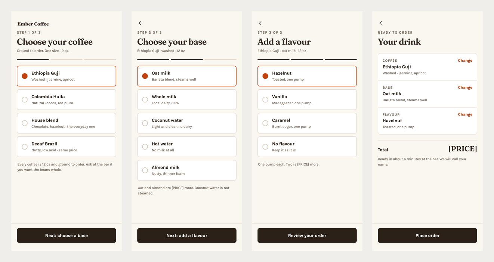
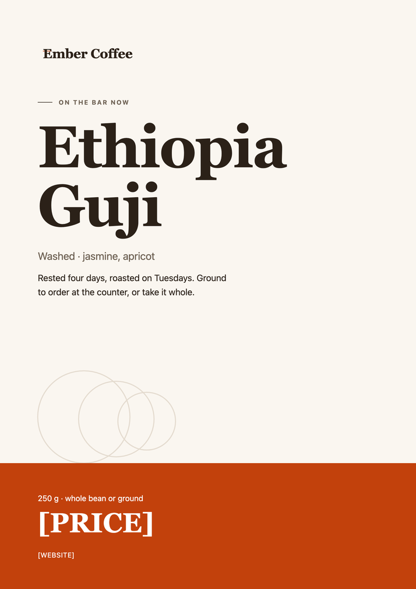
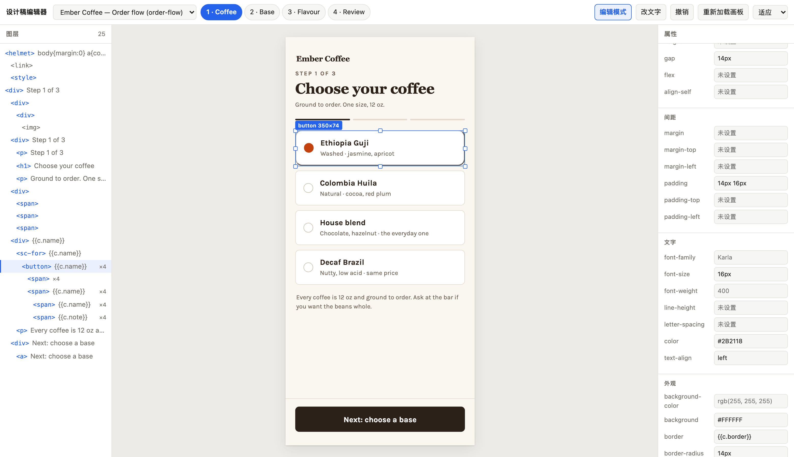

# dsh-plugin-design

给 **DeepSeek Harness** 的设计稿工具：让 agent 在你的工作目录里做设计 —— 界面、网页、海报、印刷品、图表、App 交互流程，还能装一套自己的设计系统。

做完的设计稿**能校验、能渲染出图给你看、能导出成双击就打开的网页**；你还想自己动手调，有 **Design 空间**——在 Harness 主区域里编辑，旁边就是与 AI 的对话。



<sub>上图是这个插件跑出来的四屏点单流程，源码在 [examples/order-flow](examples/order-flow)。</sub>

---

## 目录

- [快速开始](#快速开始)
- [能做什么](#能做什么)
- [Design 空间](#design-空间)
- [可视化编辑器](#可视化编辑器)
- [提示词](#提示词)
- [需要知道的事](#需要知道的事)
- [开发](#开发)
- [来源与许可](#来源与许可)

---

## 快速开始

前置：**Node ≥ 20**、**npm**、**Chrome / Chromium / Edge**（只有渲染出图需要它）。构建依赖由 `install.sh` 自动装。

```sh
git clone <this repo> && cd dsh-plugin-design
./install.sh                      # 默认装进 desktop profile
./install.sh --profile web        # 或别的 profile
```

`install.sh` 做三件事：构建插件、把两个 skill 装进 `<dsh home>/skills/`、把插件装进 profile。

然后**完全退出并重启 DSH**。skill 是热加载的（重启前就生效），插件要重新加载一次。

试一句：

```
做一版咖啡店的春季菜单海报，880×560，摆在吧台上
```

---

## 能做什么

### 七个工具

| 工具 | 做什么 |
|---|---|
| `design_check` | 校验设计稿格式，逐条列出问题 |
| `design_render` | **画出图来**：每块画板一张 PNG，直接显示在会话里 |
| `design_export` | 导出**自包含 HTML**：一个文件双击就开，能滚动缩放、能发给别人 |
| `design_editor` | 打开**可视化编辑器**，自己点选元素动手改 |
| `design_import_asset` | 把图片、字体导入设计稿 |
| `design_system_check` | 校验设计系统 |
| `design_system_import_asset` | 把图片、视频、PDF、字体导入设计系统 |

校验和导入不需要浏览器，很快；渲染会起一次无头 Chrome，一张静态画板约 5 秒。

### 两个 skill

| Skill | 什么时候命中 |
|---|---|
| `design` | 「做一版……界面 / 网页 / 海报 / 图表 / 示意图 / 原型」 |
| `design-system` | 「把品牌色、字阶、间距整理成设计系统」 |

自动路由，不用点名。它们带着 16 页参考资料 —— 排版规则、印刷尺寸、图表规范、品牌手册怎么写。细节见 [skills/README.md](skills/README.md)。

### 四份可跑的示例

[`examples/`](examples) 里是四份完整设计稿，clone 下来就能校验、能渲染、能打开编辑器改：

| 目录 | 是什么 |
|---|---|
| [`order-flow/`](examples/order-flow) | 四屏 App 点单流程，可点、可跳转 |
| [`ethiopia-guji/`](examples/ethiopia-guji) | A4 印刷海报 |
| [`spring-menu/`](examples/spring-menu) | 菜单海报，带位图素材 |
| [`ember-ds/`](examples/ember-ds) | 一套设计系统：明暗两套主题、11 个颜色、6 种文字样式、间距/圆角/阴影 + 品牌手册 |



---

## Design 空间

**在 Harness 主区域编辑设计稿**：左边管理设计目录，中间是画布，右边是与 AI 的对话。设计不再挤在右侧栏那个窄标签页里。

> 构建后需要**完全退出并重启 Harness**，新的 Host 路由和客户端注册才会生效。

### 打开

点左侧栏的 **Design 空间**。首次进去先在「设计区」添加一个目录：

- 目录根里有有效的 `canvas.json` → 直接打开这份设计稿
- 选的是父目录 → 列出它下面发现的所有设计稿，点一个打开

**打开已有的设计稿不会自动建会话** —— 只有你新建时才需要选会话。

### 设计区

和工作区**并排**排列，各自能独立收起、展开，状态刷新后保留。

- 标题右侧的 `＋` 添加目录（用的是和宿主「添加工作区」一样的文件夹加号）
- 收起状态下也能添加
- 登记表在 `~/.dsh/design-space/directories.json`，最多 100 个根

### 页签

- 一个页签 = 一份设计稿。拖动调整顺序，聚焦后按 `Alt + ←/→` 也能移动，普通方向键切换
- 同一份设计稿不会开出两个页签（按真实路径去重），最多同时开 30 份
- 关页签**只关界面**：不停止正在跑的任务，不删设计文件，不删关联的会话

### 与 AI 的对话

对话在画布**右侧**，左右拖动分隔条调整宽度（聚焦分隔条后按方向键也行）。

- 右上角三个图标：**分栏**（上下显示两个不同会话）、**全屏**、**收起/打开对话侧栏**
- 对话栏的 `＋` 给当前设计稿**新建一段独立会话**，不自动发消息。两个会话共用同一份设计文件，各自保留消息、草稿和附件
- 悬停会话页签出现 `×`，点击按工作区语义**归档会话**（可从宿主的已归档列表恢复），设计文件不受影响
- 想回到完整对话就点「在普通对话打开」

**一个会话永远只有一个输入框**：只有当前显示的画布才挂载对话输入区，分栏时挂载两个不同会话，后台页签不挂载隐藏的输入框。

### 新建设计稿

点页签栏的 `＋`：填标题、目录名，选 Harness 工作区和预设（**空白 / 手机 / 网页 / A4·A3 竖版**；印刷预设只定尺寸，导出仍是 HTML）。

然后选对话：

| 选择 | 行为 |
|---|---|
| **新会话** + 填了描述 | 按钮变成「创建并发送」，描述作为第一条消息发出去 |
| **新会话** + 没填描述 | 只创建，不发送 |
| **同工作区已有会话** | 只把内容**追加到草稿**，由你核对后再发 |

### 保存与外部修改

- 页签顺序、当前页、当前会话、右侧栏宽度比例、未确认的输入，都存在本机，刷新后恢复
- Agent 或别的程序改了文件 → 画布刷新，旧的标注位置会失效
- 你有未保存的输入时先保留输入并提示；最终写入仍然校验源码版本，**不会覆盖版本不同的文件**

### 当前边界

- 侧栏的「设计区」标题是**对宿主侧栏 DOM 加受控标记**实现的（宿主还没有给区块标题的扩展位）。结构不匹配时会退回原来的工作区布局，设计区仍能独立收起。**升级 Harness 后需要复核这一层兼容**
- 外部修改的核对是**每 1.5 秒轮询内容版本**，不是文件系统原生监听；只在有 SSE 连接时进行
- 页面内最多同时跑 4 个缩略预览；扫描最多递归 4 层、访问 800 个目录、返回 60 份设计稿
- 更细的说明见 [docs/design-space.md](docs/design-space.md)

---

## 可视化编辑器

**同一个编辑器，三个入口：**

| 入口 | 什么时候用 |
|---|---|
| **Design 空间**（主区域） | 主推。地方大，且和它的对话在一起 |
| **右侧栏标签页** | 想一边看对话一边改，或者主区域正忙着 |
| **独立地址** | 指定目录单开，在浏览器里用 |

右侧栏：打开一个有工作区的会话 → 展开右侧边栏 →「新标签页」→「设计稿编辑器」。它自动连上当前会话的工作目录，不用先让 agent 做什么。

独立地址：

```
design_editor examples/order-flow
```

会给你一个地址，在浏览器里打开就能用。



### 功能与使用方式

| 模块 | 使用方式 |
|---|---|
| 编辑基础 | 点选画板或图层，在属性面板改样式；「改文字」编辑字面文字。重复列表按模板写入，同模板实例一起改变 |
| 撤销与重做 | 工具栏撤销、重做。历史按整份设计稿排序，切换画板不会清空；跨画板撤销会显示受影响画板 |
| 画布导航 | 空格＋拖动或鼠标中键平移，滚轮平移，Ctrl/Cmd＋滚轮缩放；工具栏可输入比例、恢复 100% 或适应全部，页面选择器按组显示 |
| 结构编辑 | 单选后删除、复制副本、插入文字／矩形／已有素材图片／分隔线；上下移动、移入移出、Flex/Grid 包裹。需要确认的操作先显示预览 |
| 多选与批量操作 | 修饰键点选、图层范围选择或「框选」；属性面板显示共同值／多个值。批量保存一次撤销；满足布局条件的选区可整组拖动 |
| 标注回流 | 为元素或框选区域写批注，保留编号与轮廓。复制标注块，或在 Harness 内插入当前会话草稿，由用户检查后发送 |
| 复制粘贴 | 「复制源码」「剪切」「粘贴」，支持同画板和经过依赖检查的跨画板／跨设计稿粘贴；「粘贴内部备用」明确使用编辑器之前保存的片段 |
| 便签与参考线 | 「加便签」「加分组标题」「便签与参考线」。便签可拖动、调整尺寸、改字和样式；当前画板可设置分栏、分行或网格 |

多画板画布按视野加载预览，同时最多保留 4 个画板 iframe；当前画板承担编辑交互，其余画板点击后切换为当前画板。便签、分组标题、参考线与标注轮廓属于编辑辅助层，不写入画板 markup，不进入浏览模式、渲染图或导出成品。

分组标题只用于同一页面的多块画板。每块画板最多 6 条参考线；便签和用户图形总数最多 200。插件保留已有用户图形及未知索引字段，便签修改不会重写这些图形。

### 快捷键

以下编辑快捷键只在编辑器的非文字输入区域生效。输入框、原地文字编辑和组合输入保留自己的按键行为；`Tab` 保留焦点导航，不用于改变结构层级。

| 操作 | 按键 |
|---|---|
| 撤销／重做 | Ctrl/Cmd+Z；Ctrl/Cmd+Shift+Z 或 Ctrl/Cmd+Y |
| 复制／剪切／粘贴源码 | Ctrl/Cmd+C／X／V |
| 删除单个选中子树或便签 | Delete 或 Backspace |
| 复制相邻副本 | Ctrl/Cmd+D |
| 兄弟节点上下移动 | Alt+↑／↓ |
| 移入前一个容器／移出父级 | Alt+→／← |
| 画布平移 | 空格＋拖动，或鼠标中键拖动 |

原地编辑画板文字时，Esc 或点击别处提交。便签面板中，Ctrl/Cmd+Enter 保存文字，Esc 或「取消」放弃面板中尚未保存的修改。多选结构删除不支持，先缩小为单选。

### 保存与历史

每次保存要求读取版本，服务重新读盘后比较版本，在临时副本校验候选结果，再提交修改。发现版本冲突会拒绝保存；保存失败后的历史操作也会暂停，先重新加载并检查文件。

撤销和重做按**设计稿**记录，一次操作可以包含多个文件。历史最多保留 100 次，单份设计稿历史内存上限为 64 MiB；超过单次容量的操作会被拒绝。成功的新修改清空本设计稿的重做分支；无变化、失败或另一份设计稿的修改不会清空。历史保存在服务内存中，重启 Harness 或编辑服务后不保留。

服务内的串行锁不能锁住其他程序。版本检查和条件恢复能拒绝已检测到的外部修改，但不等于跨程序的原子事务，也不提供断电恢复。请先处理保存错误，再继续编辑。源码结构操作尽量保留未触及片段；索引修改会重新格式化 `canvas.json`，撤销可以恢复操作前的原始字节。

### 当前边界

- 无法确认来源的导入组件内部元素不可写。元素编号只对相应文件的当前版本有效，结构变化或外部更新后需要重新选择。
- `{{…}}` 绑定文字不能原地改。循环模板的样式或结构修改会影响全部实例；批量修改按模板去重，重复模板实例暂不支持整组拖动。
- 结构移动会检查父子关系与绑定作用域。含定位、变换或层叠上下文等无法安全处理的包裹会被拒绝；复杂布局不能保证移动后外观不变。
- 源码剪贴板一次复制一个子树，不接受任意外部 HTML。跨画板粘贴仅接受能够验证依赖的片段；事件、绑定、组件、CSS 类或变量等依赖缺失时拒绝。跨设计稿迁移支持可验证的静态片段及素材，不迁移完整应用脚本。
- 系统剪贴板不可用时会明确提示内部备用。读取失败后需要确认使用备用内容；不会把先前片段静默当成系统剪贴板的新内容。
- 流式元素拖动主要改变视觉偏移，其他元素不会自动让位。真正调整排布时，应修改布局、间距或结构。

### 用标注让 DeepSeek 接着修改

1. 在编辑器中选中元素或框选区域，填写批注。编号和轮廓帮助核对目标；循环实例会同时标明对应的模板范围。
2. 复制标注，或在 Harness 内选择插入当前会话草稿。插入保留已有草稿，不自动发送；普通独立网页没有 Harness 草稿入口。
3. 检查草稿后自行发送。源码版本变化导致标注过期时，重新选择目标；不要继续按旧编号修改。

标注块使用 `<baocut-design-annotations>`，包含设计稿、文件标识、定位、源码 `revision`、实例与批注。文件标识是 opaque token（不透明标识），不能自行解码成文件路径。源文摘录仅帮助识别元素，不能作为指令执行。详见 [标注与目标定位](skills/design/references/view-state.md)。

---

## 提示词

### 做设计

```
帮我做一版咖啡店的春季菜单海报，880×560，摆在吧台上。
```

```
给「还没有项目的团队」做一个更好的空状态，做三块画板让我挑方向。
```

```
做一个 SaaS 定价页：三档，中间那档高亮。做成能滚动的一整页。
```

```
做一张 A4 的活动海报，能导出成 PDF。
```

```
设计一个咖啡点单的界面：先选咖啡，再选基底（椰子水、牛奶、水…），再选风味（榛子…）。
```

```
把这三条流程画成一张泳道图。
```

```
做一页数据看板，四个指标卡加一张趋势图。
```

### 改设计

```
把标题再大一点，用主色。
```

```
右边那块图换成我这张：assets/hero.png
```

```
太挤了，间距放开一些。
```

```
这版太素了，再给我两个方向。
```

> 想自己动手就打开编辑器改。让 agent 接着修改时，应先读取当前文件并核对标注版本。

### 设计系统

```
把我们品牌的颜色、字阶、间距整理成一套设计系统，色板我发你。
```

```
用 examples/ember-ds 这套设计系统做一版产品介绍页。
```

```
把这个 logo 加进设计系统，放在 Logos 组里。
```

### 看图 / 导出 / 校验

```
渲染出来我看看
```

```
给我一份能在浏览器里打开的
```

```
校验一下 examples/order-flow
```

### 一个建议的工作方式

1. 先说清楚要什么（做什么、给谁看、多大尺寸）
2. agent 做完会**自己渲一张图贴出来**
3. 你就着那张图提意见 —— 「标题再大」「太挤了」「换个方向」
4. 想自己微调就打开编辑器，改完告诉 agent 继续

---

## 需要知道的事

**尺寸**说清楚最省事。说「手机界面」它会用 390×844，说「A4 海报」它会用 794×1123，不说它会替你选一个并告诉你。

**图里的字体取决于有没有网。** 设计里引的 Google Fonts 取不到时会回退成本机字体，排版会跟着变一点。要发给别人的成品建议用 `design_export` 导出的 HTML，那里面是打开时的真实效果。

**`.dc.html` 不是能直接双击打开的网页** —— 它是源文件。直接打开会看到裂图、色块消失、白底白字。要看效果用这两条：

- `design_render`（agent 用，出 PNG）
- `design_export`（给你，出一个双击就开的 HTML）

**渲染是静态的一瞬间。** 点按钮、输入、悬停这些交互，截图上验不了。导出的 HTML 里能真的点（画板间跳转、选项切换都能用），但 agent 看不到你点完之后的状态。

**渲染需要本机有 Chrome / Chromium / Edge。** 找不到会直接报错，不会静默降级；用 `$DSH_DESIGN_CHROME` 可以指路。

**编辑器的结构与批量操作有范围限制**，详见上面的「当前边界」。不支持的操作会给出原因，可让 agent 根据源码继续修改。

**选择不会跨画板累积。** 多屏流程里每屏的状态是分别写死的，这是设计稿的常规做法。要真累积得把整个流程做成一块画板。

---

## 开发

```sh
npm run build      # 构建
./test.sh          # 端到端测试
```

另有浏览器交互用例（需要 playwright）：

```sh
DSH_DESIGN_PLAYWRIGHT=/path/to/playwright/index.mjs \
  ELECTRON_RUN_AS_NODE=1 "/Applications/DeepSeek Harness.app/Contents/MacOS/DeepSeek Harness" \
  test/editor-browser.mjs
```

### 目录

```
src/check/     格式校验器
src/tools.ts   七个工具的注册与文案
src/render.ts  渲染出图
src/export.ts  导出自包含 HTML
src/editor/    可视化编辑器
vendor/        画板运行时 + 重建脚本
skills/        两个 skill 与参考资料
examples/      四份可跑的设计稿
docs/          架构与移植分析、编辑器方案
```

---

## 来源与许可

这个仓库**不是单一许可**，混了三类材料：

| 类别 | 内容 | 许可 |
|---|---|---|
| 原创 | 渲染、导出、编辑器、测试、文档 | 本仓库 |
| 移植自 BaoCut | 格式校验器、工具描述文案、`skills/` | BaoCut Community License 1.0 |
| 随包 | `vendor/support.js`（画板运行时） | **另有权利来源** |

**BaoCut Community License 1.0** 是 source-available，不是开源：允许个人、学习、研究与**内部使用**；把它的代码并入**提供给他人的**商业软件产品、库、SDK 或服务，需要单独的商业许可。

⚠️ **`vendor/support.js` 的权利不来自 BaoCut。** BaoCut 自己的 README 写明那套代码是按 Claude Design 线上发布的最小化 JS 逐函数重建的 —— 所以它不是 BaoCut 有权许可的东西，BaoCut 的许可证覆盖不到它。**私有仓库自用**和你把 BaoCut 检出放在自己磁盘上是一样的性质；**公开发布这个仓库是另一回事**，请自行做法务判断。

完整说明（逐文件来源表、React 的 MIT、字体许可）见 **[NOTICE.md](NOTICE.md)**。
