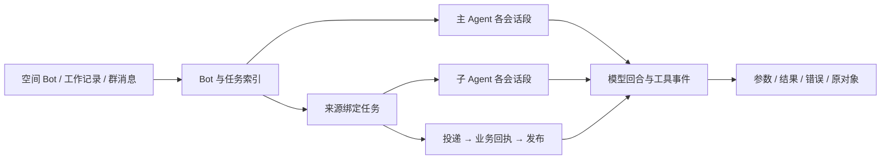
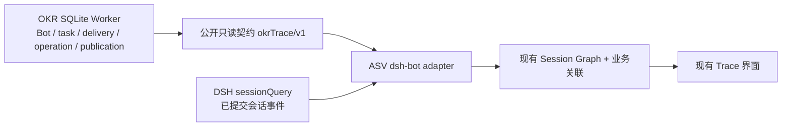

# Bot 执行轨迹接入方案

状态：用户已要求按原型实施，功能联调中。2026-10-27 根据用户“查看各个 Bot 的执行轨迹，让 Trace 界面接入”的需求，核对当前源码后提出。产品增量见 [Bot 执行轨迹需求](../../../../../learning/原型设计/目标日程插件/需求/2026-10-27-Bot执行轨迹/产品设计.md)。本轮版本为 OKR 3.1.0 与 ASV 1.1.0；实际验收结果见本次 spec。

## 建议与范围

复用 Agent Session Visualizer（下称 ASV）已有 Trace 页面，新增 `dsh-bot` 数据源。OKR Host 提供公开、只读、按来源约束的运行索引；ASV 用 DSH 公开会话查询读取宿主已提交的事件，包括实时快照和持久化历史，再转换成现有轨迹结构。实时可见不保证日志缓冲已经刷盘。两个插件独立发布，不导入对方内部实现，不复制完整会话日志。

首版覆盖所有空间 Bot 的主 Agent、任务子 Agent、历史会话段，以及综合群的协调和派发步骤。记录、生成方案、规划等一次性模型调用若尚无持久关联，只显示已有工作流事实；补上关联后才提供对应模型会话入口。综合群当前没有持久协调 Bot 主会话，不能生成一条虚构的 Agent 会话。

本文件首先交付接入方案，随后完成适配既有风格的可操作 [UI 原型](../../../../../learning/原型设计/目标日程插件/需求/2026-10-27-Bot执行轨迹/UI设计原型/BotTrace.html)；原型只使用合成数据。用户体验后要求“实现这个功能”，据此确认本需求的原型实施范围。方案、原型、工程测试与真实 DSH 验收分别记录。

## 开发前核实的基线

| 事实 | 源码依据与影响 |
|---|---|
| DSH 会话里的 `Trace` 由 ASV 注册 | [client.js](../../../agent-session-visualizer/client.js:568) 注册 `conversation.view` 的 `id: trace`；不是 DSH 自带的通用日志阅读器。 |
| 当前内嵌 Trace 只传会话 ID | [client.js](../../../agent-session-visualizer/client.js:512) 拼接 `?session=`，未传数据源；[app.js](../../../agent-session-visualizer/app.js:3) 默认 Codex，不能直接识别 OKR 的 DSH 会话。 |
| ASV 没有 DSH 数据源 | [server.mjs](../../../agent-session-visualizer/server.mjs:13) 只登记 Codex、Grok、Claude、Noval。 |
| ASV 服务与插件处于同一 Host 进程 | [index.js](../../../agent-session-visualizer/index.js:15) 直接调用 `startServer`；可注入公开只读服务，不必另建跨进程日志镜像。 |
| OKR 已有 Bot、任务及历史会话段映射 | [bot.js](../../src/host/bot.js:53)、[换段逻辑](../../src/host/bot.js:135)、[任务创建](../../src/host/bot.js:219) 可提供稳定索引；当前面向聊天的投影没有开放完整映射。 |
| 实时父 Agent 不等于持久分支血缘 | [dsh-adapter.js](../../src/host/dsh-adapter.js:118) 使用 `parentAgent`，没有写持久 fork 的 `parentSession`。关系图必须采用 OKR 的任务归属映射，不能只依赖原生父子查询。 |
| DSH 已有公开只读查询 | [dsh-adapter.js](../../src/host/dsh-adapter.js:134) 已通过 `sessionQuery.observeSession` 核对事件并释放观察对象。查看轨迹不需要创建或恢复 Agent。 |
| 不能保证用原生会话导航直接打开 | 当前 OKR Session 没有工作目录，子会话还缺少原生历史页要求的持久 subagent 地址关系。`uiWorkspace.openSession` 只选择会话，不保证历史加载成功；首版在 ASV 面板直接读公开会话查询，不伪造工作目录或 fork 血缘来绕过原生门禁。 |
| Super Agent Trace 面向另一个运行系统 | [client.trace.js](../../../dsh-bridge/src/client/client.trace.js) 使用 Core conversation/fact 标识；不把 DSH 的 `sessionId` 当作 Core `conversationId`。本轮不改该插件。 |

## 查看入口与页面

1. **空间 Bot。** 在 Bot 标题旁增加“执行轨迹”。打开当前 Bot 总览，显示主 Agent 的当前来源投影和该来源可见任务，保留返回原空间的入口。主 Agent 完整历史只从明确的本机诊断范围进入。
2. **某次工作。** 在“当前工作与工作记录”每项增加“查看轨迹”。打开时直接选中原任务及最新一次投递；错误卡片定位失败事件，不发送新消息或恢复工作。
3. **综合群。** 群消息和协作进展增加“查看协作轨迹”。显示原群消息、授权分片、接收 Bot、任务、真实操作与原群发布；不包含成员私聊。
4. **全部 Bot。** ASV 的数据源选择器增加“日常助手 Bot”。先按空间和 Bot 浏览，再进入任务或主 Agent。列表按需分页，不在首次打开时读取所有会话正文。
5. **已有 DSH 会话的 Trace 页签。** 先通过公开索引解析该会话是否属于日常助手；匹配后明确选择 `dsh-bot` 并定位相应会话段。未匹配时保留其他来源的现有行为，但不误选一条最近的 Codex 会话作为结果。

总览沿用三栏：左侧为“Bot → 主 Agent／任务 → 会话段”；中间为选中范围的时间线；右侧为事件详情和关联对象。可以按私聊／综合群、任务状态、工具、错误筛选。事件默认展开到模型回合和工具级，正文、参数和结果按需展开。

Bot 总览是导航与因果关系视图，不把多个物理会话伪装成一条 Conversation。点击某个会话段后，复用现有单会话 Trace；返回总览时保留任务、筛选及选中事件。

客户端导航通过可取消事件 `asv-open-bot-trace` 传递 `{v:1,source,objectiveId?,taskId?,groupMessageId?,sessionId?,focus?,returnTarget?}`。ASV 接收并同步 `preventDefault()` 后切换面板；返回通过 `asv-return-bot-trace` 传回原空间、页面与消息标识。未发送草稿仅保留在工作台模块内存，不交给 iframe。`focus` 使用明确事件、工具调用或业务回执引用；命中后高亮，缺失时明确显示尚未记录。来源不可用、目标缺失时不回退到其他来源的最近会话。

## 数据与接入边界

- **OKR 是运行关系和业务事实的权威来源。** 只读契约返回 Host 核实的会话白名单、任务归属、来源和业务关联。不能向前端直接开放 `runtime.load` 整份状态。
- **DSH 是模型与工具事件的权威来源。** 由 ASV Host 适配器通过公开 `sessionQuery` 查询，OKR 不再实现第二个原生事件 Reader。不直接解析用户日志文件，不调用 `agents.resume`，不因查看而触发 `kick`、执行工具或发送恢复消息。实时提交水位与持久化覆盖范围分开标明，重启后仅重现实际保留的历史。
- **ASV 负责展示投影。** Host 通过 `ctx.provide` 与动态 `ctx.inject` 连接公开服务；两个插件须在同一 isolation scope，在当前 profile 内登记数据源。无法取得公开服务时明确不可用，不改读对方文件。服务卸载时撤销可见源和读取能力。独立 `npm start` 没有 DSH Host 时明确显示此源不可用，其他四个来源照常工作。
- **不引入第二份日志库。** 新增持久内容仅为轻量关联和生命周期事件，保存在所属 O 或群的现有 SQLite 中；正文与原生模型轨迹仍从各自权威来源读取。
- **保留现有接口。** 包名、Loader、客户端 ID、`conversation.view` 的 `trace` ID、ASV 端口及其他 Provider API 不变。新数据源使用独立版本化契约；不向 Super Agent Core 提交 OKR 的标识。

DSH 查询能力核对如下。以已安装 0.2.1-rc.3 的公开接口为准，接入时做能力检测：

| 已有方法 | 可用范围与边界 |
|---|---|
| `observeSession(id, {signal, projectionMode})` | 一次不可变观察，提供 header、events、末序号 cursor 等。它不是持续订阅；每个观察 lease（含 retain 得到的副本）都须 dispose。 |
| `readSession(id)` | 完整事件读取和校验，不启动 Agent；不是带 afterSeq 的分页查询。 |
| `readEvent({sessionId, seq, before, after}, signal)` | 返回单条及有界邻域，内部仍可能加载完整日志，不能当作常数成本的磁盘随机读取。 |
| `readSurface(id)` | 当前模型表层及其水位，不保证提供每次历史请求快照，也不等于 Provider 最终 HTTP 请求体。 |
| `traceSession(id, signal)` | 依赖持久 parentSession 的会话血缘，不代替 OKR 的 Bot／任务／段关系。 |

以上 API 自身不提供调用方授权，ASV 必须先取得 OKR 给出的固定会话范围。`session/event` 是当前作用域已提交的追加通知，不是逐 token 流，也不等于文件已 flush；不能假设 ASV 插件作用域自动收到所有 Agent 事件。后续可由 OKR adapter 向公开服务转发获准通知，采取“先监听缓冲、再读快照、按 seq 去重、缺口重读”，并在离开或服务卸载时释放订阅。首版增量轮询不依赖这项实时转发。

## 公开只读契约

服务名为 `okrTrace/v1`，通过宿主公开服务机制连接；数据契约由 OKR 维护版本，ASV 只依赖公开返回值，不导入 OKR 内部模块。

| 接口 | 返回与约束 |
|---|---|
| `trace.capabilities` | 契约版本、可用事件类型、历史覆盖范围和数据源状态。 |
| `trace.bots.list` | 可见 Bot／空间名称、可见任务数量、最近活动和分页游标；不返回全部正文。 |
| `trace.tasks.list` | 当前 Bot 下的来源绑定任务、业务状态、驻留状态、最近交付和错误。 |
| `trace.task.get` | 原输入、主 Agent 派发、子会话各段、投递尝试、真实业务回执、发布及父通知的关联。 |
| `trace.session.resolve` | 将宿主提供的 DSH 会话 ID 解析为已登记 Bot／任务／段；无法匹配时明确返回未登记。 |
| `trace.stream.authorize` | 签发绑定当前查看范围的 `streamRef`，列明哪些会话可读原生事件、哪些只允许 Host 来源投影；不接受任意文件路径或任意会话 ID 作为授权。 |
| `trace.events.list` | 只读取 OKR Host 的关系、生命周期和业务关联事件，使用不透明游标和条数上限；不返回 DSH 原生事件副本。 |
| `trace.event.get` | 只展开属于当前范围的 Host 事件及其业务证据；原生事件和模型请求详情由 ASV 适配器通过 DSH 查询提供。 |

调用范围由本机诊断入口、空间或群入口确定，不能由 iframe、模型参数或 `sessionId` 自行扩大。ASV 组合 OKR 的 Host 事件与自己读取的 DSH 原生事件后，向 Trace 提供统一投影；两类读取职责不重复。会话白名单只代表归属，不自动授权全文读取。受限来源的混合主会话不列入原生全文读取范围，只使用 OKR 的来源投影；其他会话按授权字段读取，不扫描整个用户会话目录。

运行中首版按 1～2 秒增量轮询；关闭页面后停止。游标至少区分 Host 关联事件序号与各物理会话的原生 `seq`。跨会话以因果边关联，不能仅按时间戳推断先后。原生 API 没有同等增量分页能力时，由适配器维护有界内存投影并去重，不能声称宿主本身提供了游标协议。

## 事件与关联

逻辑任务 `taskId`、Host 投递执行 `runId` 和模型回合不是同一概念。当前 `runId` 来自 `deliveryId`，恢复会复用；新增 `attemptId` 区分本次尝试，保留现有标识和业务幂等语义。

| 层次 | 首版需要展示的事件 |
|---|---|
| 接收与派发 | 来信接纳、群分片、创建／续接任务、投递接纳、等待队列。 |
| 模型与工具 | 原生模型回合、模型请求与返回、宿主已记录的 reasoning 摘要、工具调用与结果、错误和真实用量。没有记录的内容显示“未提供”。 |
| 业务写入 | `saved`、`pending`、`unsupported`、`conflict` 等实际回执，关联事项或待整理材料。只读回执与持久业务操作分开。 |
| 交付 | `task.report`、答案发布到原私聊／群、父 Agent 状态通知。答案已发布、父通知仍运行可同时成立。 |
| 生命周期 | 等待补充、取消、冷却／休眠、会话换段、失败、恢复、同一投递的不同尝试。 |

事件按实际存在的字段携带 `botId/objectiveId/sourceScope/taskId/sessionId/contextGeneration/deliveryId/attemptId/runId/callId/operationId/publicationId` 与因果引用。无关联的字段留空，不能按相近时间猜配。

查看“为什么没保存”时，用户应能看到工具实际返回 `pending` 和缺项；查看“为什么重试”时，用户应能从失败尝试跳到同一投递的恢复尝试；查看“保存后没回复”时，应能区分业务已提交与发布未完成。

## 必须补齐的记录

1. **原生事件出口。** 当前 adapter 对外转发 `tool/request`，实际 DSH 事件包含 `tool/call`；Bot 回调又主要保留答案。接入时核对实际事件 schema，补齐回合、请求、工具与错误事件，保留原 `sessionId + seq + callId`，不从流式文字猜工具调用。
2. **尝试与会话段历史。** 当前 outbox 只保存累计次数，任务的当前 run 会被后续运行覆盖。新增尝试起止、会话段、原投递、恢复消息与结果关联。现有旧段只有有限的会话 ID、原因和时间，补充新段的前段引用、代次及范围水位；旧段缺失字段保持未知。恢复不画成新任务，换段不冒充原生 fork。
3. **发布与业务操作。** `task.report` 已校验 `operationRefs`，publication 尚未持久保留本次完整关联；群发布因此缺精确操作链接。补存本次引用，不能把该任务历史所有回执都挂到每条答案。
4. **工作流模型调用。** 综合群协调、方案生成及规划调用需要记录自己的模型会话引用和调用目的。没有引用的旧调用只展示已知协调事实，不补造会话。
5. **轻量事务事件。** 任务／投递／操作／发布提交时，在同一 SQLite 事务追加引用型事件，保留顺序和去重键。不开启无限增长的全文镜像，也不让观察器写入业务状态。

旧数据可先展示已有任务映射、原生日志和真实业务回执。缺少的尝试时间、历史状态或发布关联标为“历史未记录”。新索引上线后的完整度单独标记，不把读取时推断写回成既有事实。

## 来源与传输约束

- 空间私聊入口默认只显示该私聊任务；群入口只显示该群派发和群任务。主 Agent 的同一物理会话可能混合多个来源，普通私聊和群视图仅显示当前来源的 Host 派发投影，不能展开混合主会话全文。过滤发生在 Host 响应、缓存和导出之前，不能先向浏览器发送全量内容再隐藏。缓存同时绑定 profile、查看范围和来源，不能复用诊断总览的全文缓存。
- 本机用户从“全部 Bot／诊断总览”明确进入时，可查看自己选定 Bot 的完整主 Agent 轨迹，并标明“包含本 Bot 的多个来源”。这种诊断读取权不交给 Bot 工具，也不随群消息发布。
- 工具原始结果和业务回执需要核对任务归属；同一个 O 的任意 `operationId` 不能作为该任务的读取授权。
- 新源不能直接沿用 ASV 现有的无范围 HTTP 读取及通配 CORS。DSH 壳层通过宿主入口取得短期、只读、固定 profile 和查看范围的能力凭据；仅保存在内存。iframe 握手核对确切 origin 和 `contentWindow`，凭据不写 URL、日志或本地存储；该数据源的列表、详情和增量请求都校验范围，不能只保护目录。
- ASV 已复用的服务必须确认属于当前 Host/profile，并支持新契约和鉴权后才能接入。端口被独立 ASV 占用时，不向该进程发送 Bot 凭据或正文；显示接入不可用。
- 不自动把 Bot 轨迹发送给现有摘要服务。用量没有上报时显示未知，不把未知当零，不用累计答案数冒充模型请求次数或直接推导缓存命中率。

## 实施批次与验收

| 批次 | 范围 | 合并验收场景 |
|---|---|---|
| 只读索引与会话轨迹 | OKR 公开范围接口、ASV 新源、Bot／任务目录、历史段、明确导航与鉴权。 | 同一 Bot 下多个任务；重启后仍可定位；群与私聊不串；查看已关闭 Agent 不恢复或重放业务；旧历史缺口可见；其他四源回归。 |
| 业务因果与恢复 | 轻量事务事件、attempt、恢复关联、工具／业务回执／发布、协调流程模型引用。 | 缺项补全仍是原任务；超时恢复仍是原投递；已保存但未发布、已发布但父通知未结束可区分；并行子任务与换段关系正确。 |
| 运行中体验与实机接入 | 增量读取、按事件定位、入口返回状态、按需详情及真实 DSH 联调。 | 持续执行时增量追加且不重复；断线续读、关闭清理；多 Bot 概览不读全量正文；部署后从私聊、工作记录和群进入，定位同一真实回执。 |

用户已要求按原型实施。开发与验收持续更新本次 [spec](spec.md) 及 [ASV 接入记录](../../../agent-session-visualizer/docs/2026-10-27-bot-trace/spec.md)。本方案未承诺缓存优化或模型性能提升。
