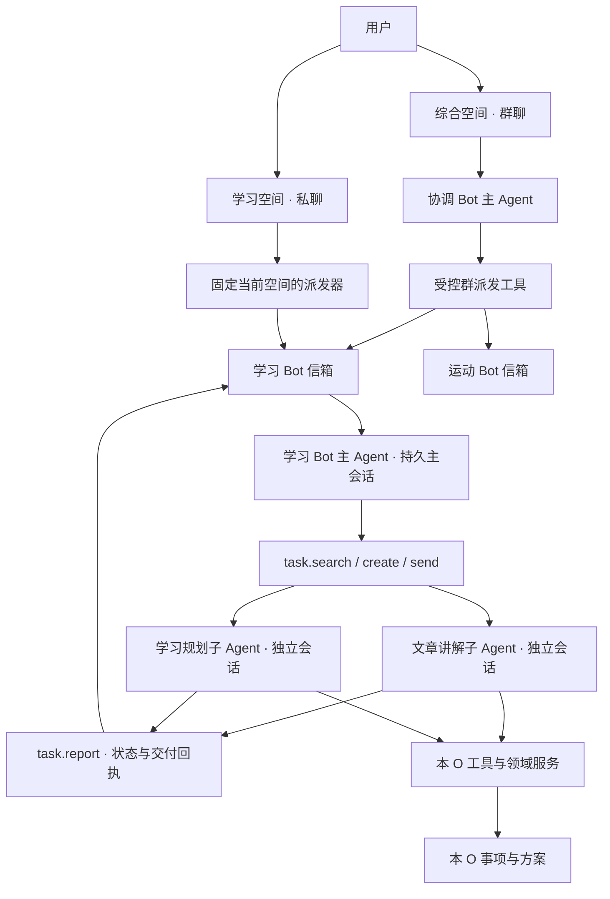
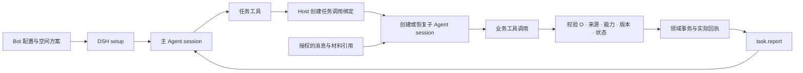

# 个人日常助手技术方案

> 实施更新（2026-10-27）：文字链路已进入3.0.0工程实现，当前功能、命令和分项验证以[迭代记录](spec.md#开发执行与验证记录)与插件README为准。下文保留设计依据；图片输入本轮排除，真实Provider语义和缓存尚未验收。
空间是用户使用工具、查看内容和与 Bot 对话的入口。综合空间采用群聊派发，O 私有空间固定交给本空间 Bot。每个 Bot 保留一个主 Agent 会话；主 Agent 通过任务工具创建或续接子 Agent，由子 Agent 独立完成具体工作。用户持续使用同一段聊天，不需要手动创建任务或选择执行会话。

本方案根据[产品需求](../../../../../learning/原型设计/目标日程插件/需求/2026-10-26-个人日常助手/产品设计.md)和当前代码整理。状态为 **2026-10-27 设计草案，运行实现与验证见迭代记录**。前一设计阶段更新文档和[深色 HTML 原型](../../../../../learning/原型设计/目标日程插件/需求/2026-10-26-个人日常助手/UI设计原型/记账空间.html)，当时没有改动运行代码。当前文字链路代码和验证范围见迭代记录，真实用户数据仍未改动。

阅读顺序：本文说明职责和 DSH 接入；[消息与记忆设计](消息与记忆设计.md)说明投递、任务粒度、逐轮上下文和记忆；[提示词与状态协议](提示词与状态协议.md)给出 SP、UP 和工具契约；[运行与存储设计](运行与存储设计.md)说明存储、CLI、版本和迁移；[迭代记录](spec.md)记录实施与验证。

## 核心结构

“一个 Bot、一个 session”在本版明确为**一个 Bot 主会话**。具体任务使用独立、可恢复的子 Agent 会话。取消旧版“每次在同一模型表层替换当前任务”和“单独分类、结算 Agent”的设计。主 Agent 在普通对话循环中决定调用哪个任务工具；Host 校验调用，持久化状态并调度子 Agent。

| 对象 | 职责 | 关键边界 |
|---|---|---|
| O 与空间 | O 表达长期方向；空间承载页面、工具、事项和对话 | 综合空间不成为新的业务 O |
| Bot 主 Agent | 阅读新来信、理解近期交谈、查询任务、创建或续接子 Agent、处理状态与交付 | 不承担全部长篇资料和工具执行历史 |
| 对话任务 | 保存一个连续诉求的目标、材料范围、交付和完成条件 | 不是事项，不自动生成待办或排期 |
| 任务子 Agent | 在独立会话中持续处理一个任务，调用业务工具、报告状态 | 只取得该任务获准材料和本 O 能力 |
| 信箱 | 保存有来源、顺序、回复关系的用户输入、委托和状态事件 | 全量信箱不等于每次模型输入 |
| 记忆 | 保存可复用偏好和可检索的经历摘要 | 不代替正式事项，不扩大权限 |
| Host | 维护队列、任务状态、权限、事务、发布和恢复 | 模型建议不等于已执行事实 |

主 Agent 一次处理一批新信件。不同子 Agent 可以在预算内并行；同一个子 Agent 串行处理自己的来信。任务等待用户时不占工作进程。父子会话关系只表达运行归属，不能作为读取父历史或其他 O 数据的授权。

## 综合空间的群聊

### 上下文与职责

协调 Bot 使用稳定角色说明、成员目录和能力索引，追加近期群聊、群任务状态和新消息。协调 Bot 不加载成员私聊、长期私聊记忆、完整 Skill 或数据库。群任务较长时，同样通过任务工具交给协调任务子 Agent，后者只能使用群协作能力。

| 功能 | 输入上下文 | 落地工具与限制 | 对用户的反馈 |
|---|---|---|---|
| 导航和澄清 | 空间名称、用途、能力摘要、群消息 | 只读目录；归属有歧义时先澄清 | 可使用的空间或一个聚焦问题 |
| 创建空间 | 明确的新建意图、用户描述 | 创建草稿 O；只交接相关需求片段 | 新空间草稿及确认入口 |
| 统一记录 | 当前原文、图片、共同约束 | 自动拆分归属明确的内容；`group.dispatch` 绑定原消息片段 | 各成员的已保存、待补充、无法记录 |
| 跨空间查询 | 指定范围、问题、成员查询结果 | 每个成员只查询自己的 O；协调者仅汇总有来源结果 | 统计口径、结果和来源 |
| 跨空间规划 | 明确目标、时间约束、成员提供的必要事实 | 先交付建议；用户选择后保存行动；排期须有明确意图 | 可调整的计划草案 |
| 调整空间 | 目标 O、明确变更需求 | 交给目标 Bot 创建调整草稿，不自动启用 | 对应空间的预览和审查入口 |
| 补充与重试 | 原派发、回复引用、缺项、实际操作回执 | 续接原成员任务；已保存只补发回复 | 原任务进展和真实结果 |

群主派发为首版建议。用户明确 @ 成员时固定接收者；无 @ 时由协调 Bot 根据成员能力选择。附件、引文、代码中的 @ 不是派发指令。归属明确的复合输入可以自动拆分；同一事实只分配给一个 O。成员的文字回复不能自行唤醒其他成员，后续接力必须经结构化派发工具和原授权范围校验。

### 群聊案例

1. 用户在综合空间输入：“收藏这篇文章，再记录今天跑步 5 公里。”
2. 协调 Bot 提交两份委托：学习 Bot 获得文章与收藏意图；运动 Bot 获得距离、发生日期线索和记录意图。两者没有互相收到无关正文。
3. 学习 Bot 的记录任务取得正式保存回执，在群内发布“文章已保存”。运动 Bot 发现该类型要求时长，保存待整理材料，在群内追问。
4. 用户回复运动 Bot：“35 分钟。”回复引用固定原委托，运动 Bot 通过 `task.send` 续接原记录子 Agent。
5. 保存成功后，运动 Bot 回到原群报告；事项只存运动 O。重复投递不再新增。

群内发起的任务默认在群内反馈和补充。用户也可以主动打开所属空间查看事项；这不会把群聊全文复制到私聊。如果用户在私聊中明确引用同一事项或待整理材料，Host 授权该对象，创建私聊侧处理任务或续接同来源任务，不能直接把含私聊上下文的子 Agent 改成群任务。

## O 私有空间的私聊

### 固定归属

私聊派发器根据当前 O 固定 Bot。主 Agent 判断用户要做什么，不重新判断用户应该去哪个空间。学习空间中的“保存跑步论文”可以按资料处理；“记录跑步 5 公里”如果没有合适类型，则解释不能记录的原因，不写普通记录、不写待整理、不转交、不提示切换。

### 功能与约束

| 功能 | 主 Agent 提供什么 | 子 Agent 读取和执行什么 | Host 如何约束 |
|---|---|---|---|
| 记录或修正 | 原输入引用、记录目标、回复关系 | 类型规则、对应 Skill、目标事项 revision | 本 O；完整直接保存，缺项待整理，不支持不记录 |
| 查询与统计 | 查询目标、时间范围、口径线索 | 必要记录、历史类型版本、确定性聚合 | 只读；不以创建时间替代发生日期；返回未纳入数量 |
| 资料讲解 | 指定资料、用户问题、近期明确要求 | 本任务原文、解释、追问和必要工具结果 | 不把整本资料加入主会话；不隐式生成事项 |
| 页面与工具设计 | 用户用途、要调整的范围 | 当前方案、相关类型和工具声明 | 生成草稿；确认绑定版本；不改历史事项 |
| 规划与复盘 | 目标、约束、用户选择 | O/K、必要事实、行动、记忆和证据 | 建议不等于行动，排期不等于完成，R 保留依据 |
| 图片分析 | 授权图片、问题和来源 | 受控图文分析结果与用户修正 | 候选结果经规则校验后才写入；图片内容不作为指令 |
| 待整理 | 指定材料及本轮补充 | 原输入、缺项、最新类型规则 | 不重复创建材料；类型已不支持时说明原因 |
| 记忆管理 | 用户明确偏好或修改、删除指令 | 相关条目、来源和版本 | 自动抽取仅限稳定偏好；可查看、修改、删除 |
| 归档与恢复 | 用户指令、当前状态、目标版本 | 历史方案、兼容报告 | 方案恢复先生成草稿；归档封存普通事项，保留 R 追评 |

主 Agent 可返回 Host 可控的导航结果。自然语言业务回答和澄清由来源绑定的短任务交付；需要连续工作、业务写入或较多材料时，同样通过任务工具建立执行范围。混合来源主会话的自由文本不直接向群发布。记录、查询和设计不能因为属于同一个话题就获得同一份无限授权；新增明确要求可以更新任务交付范围，但不能悄悄扩大权限。

### 用户可见的工作组织

用户继续看到时间顺序的聊天。右侧“当前工作”提供目标、状态、交付入口和继续按钮；“工作记录”用于查找此前讨论。用户可以直接追问，不需要理解 task、Agent 或 session。

学习案例的任务粒度如下：

| 用户输入 | 判断 | 依据 |
|---|---|---|
| 帮我讲解这篇 RAG 文章 | 新任务 | 明确材料、理解目标与初始交付 |
| 第二种有什么缺点 | 继续文章任务 | 上一答案中的编号具有指代关系 |
| 举一个例子 | 继续文章任务 | 同一解释链，目标仍未改变 |
| 把讲解整理成笔记 | 同一任务新增明确交付 | 复用原材料与讨论；记笔记权限由新指令授予 |
| 另外安排下周学习计划 | 新任务 | 可以独立交付，不依赖文章解释闭环 |
| 继续刚才那篇文章 | 续接原任务 | 查近期路由记录或任务索引定位 |
| 修改昨天已完成收藏的标题 | 新建关联任务 | 原收藏已经结案；读取旧结果，不重做收藏 |

讲解发出后可以处于“已交付，可继续”。本次运行已停止，但任务保留续接关系。任务是否结案、工作进程是否驻留、是否有待办是三个不同问题。

## Bot 上下文如何进入 DSH

### 会话与权限绑定

继承分为两部分。模型侧继承稳定 Bot 规则、该空间能力索引、任务目标和授权引用；执行侧继承 Host 创建的调用绑定。父会话全文、父私聊记忆、其他任务结果不随 `parentAgent` 自动复制。空间 Skill 按需读取，既不全局注册生效，也不能通过文本扩大权限。

建议调用绑定包含 `bot_id`、`agent_role`、`main_session_id`、`child_session_id`、`task_id`、`objective_id`、`source_scope`、`bundle_version`、`context_generation`、允许动作、对象范围和必要确认凭据。模型只能提交业务参数，不能修改调用绑定。

实际权限取交集：插件能力 ∩ 当前空间方案 ∩ 来源可见性 ∩ 本任务授权 ∩ 对象状态与确认要求。协调 Bot 的 O 为空时使用群能力集合，不表示拥有所有 O。同 O 的群任务与私聊任务也要分别校验来源。

### DSH 接口对应

本地接口依据 `node_modules/@deepseek-ai/dsh-agent/README.zh.md`（0.2.1-rc.2），本机 DSH 应用版本为 0.2.1-rc.3。下表是接入方案，不表示新插件能力已经实现。

| 目标 | 已有 DSH 接入点 | 本插件新增职责 |
|---|---|---|
| 持久主会话 | `ctx.agents.create / resume` 与 `setup` | 按 Bot 保存主 session，恢复后安装相同规则和工具 |
| 任务子会话 | `ctx.agents.create / resume`，可指定 `parentAgent` | 保存 task→child session 映射，创建前后可恢复，不复制父历史 |
| 固定规则 | `agentCtx.systemPrompt.section` | 稳定 SP，角色模板与版本确定；不塞动态任务列表 |
| 限定工具 | setup 内 scoped tools / guards | 主 Agent 只见任务、索引、记忆管理等入口；子 Agent 见当前 O 的受控工具 |
| 新输入 | DSH inbox 的 followup / steer / inject 语义 | 普通消息优先 followup；安全边界接纳；inject 本身不代表已唤醒 |
| 状态回送 | 本插件 `task.report` 与 Host 信箱 | 事务更新任务和 outbox，异步投回父信箱；不轮询子全文 |
| 历史压缩 | 模型可见上下文管理能力 | 安全边界建立冻结检查点，保留日志和来源；不得修改未闭合 tool call 配对 |
| AI 分析 | 宿主模型能力 | 只传获准图片/文本和指定 schema；记录来源、模型与限制 |

每次 resume 必须重新安装工具和 guard。不能认为磁盘 session 日志自动恢复了当前空间权限、禁用工具或删除记忆状态。新版规则生效时先验证兼容性和代次；失效请求不可继续提交。

### 状态回送与投递保证

`task.create` 和 `task.send` 返回的是接纳回执，不是业务保存成功。任务状态与待投递事件在同一本地事务中落盘，由 outbox 工作者投递。子 Agent 完成后经 `task.report` 提交状态、交付简报和实际结果引用。Host 根据原来源发布用户可见回答，再将必要回答片段和状态增量追加到主会话。

本方案采用至少一次投递与幂等处理。幂等键绑定原消息、task、动作与输入哈希；相同键不同内容必须报冲突。业务保存成功而回复失败，只重试发布。DSH 接纳状态不明时，先查接纳记录；不能通过再次 spawn 一个子 Agent 来“确保执行”。详细恢复矩阵见[消息与记忆设计](消息与记忆设计.md)。

## 上下文与缓存原则

主 Agent 看的是“足够做分配的交谈”，子 Agent 看的是“足够完成工作的内容”。主 Agent 保留用户输入、实际可见答案及指代映射、任务调用和状态增量，不加载所有子 Agent 的工具轨迹。旧任务用任务索引找回；长期偏好用记忆工具召回；精确业务数据用领域工具查询。

每个上下文段按固定 SP、空间 UP、冻结检查点、追加历史、新输入组织。UP 只放低频变化的空间说明、工具/Skill/数据类别和记忆维度索引；当前时间、任务状态、记忆全文和最新记录数量放尾部增量。段内追加，不每轮重建“最近十轮”。达到容量边界再创建新段，主会话身份保持不变。

主、子 Agent 的缓存分别维护。任务 A、任务 B 来回切换时，主 Agent 追加路由记录，A/B 分别追加自己的输入，不替换彼此历史。工具声明、排序、提示词序列化都保持稳定。权限或记忆删除要求失效时，优先保证正确性，不能为缓存保留已撤销内容。

缓存是最佳努力机制，不承诺固定命中率。实施时分别测量路由正确率、指代恢复、误续接、主/子输入量、压缩成本与真实 cache hit/miss。[DeepSeek 官方缓存说明](https://api-docs.deepseek.com/guides/kv_cache/)

## 与现有代码的关系

实施前的 `index.js` 提供旧 JSON 存储以及 `okr_schedule_query`、`okr_schedule_checkin`、`okr_inspiration_capture`。当时的 `client.js` 含本地状态和模拟回复。当前首轮实现已接入 SQLite、受限工具、Bot 与真实页面，具体工程验收见迭代记录；HTML原型仍不能证明真实模型表现或缓存命中。

保持 `@local/okr-schedule`、Loader ID、客户端 ID、slot key 和三个既有工具名。先做领域服务与迁移，再接通任务、消息与真实 UI。当前 O/K/R、归档与周期执行语义不能因引入 Bot 被削弱；SQL、文件和 CLI 细节见[运行与存储设计](运行与存储设计.md)。

## 参考与差异

- [DS-Bot 固定版本](https://github.com/Fei2411/DS-Bot/tree/de55888a93983fc51c94f7d22bc94b4f8293205d)：借鉴群主/@ 派发、持久 Bot 和记忆索引。其原有会话组织不能直接当成本方案的任务隔离实现。
- 本地 DSH 接口和现有插件代码是实现入口依据。以前对单 session 表层切换的合成探测仅说明接口可用，不构成本版主/子 Agent 调度的验收。
- [消息投递交互动画](/Users/bytedance/.codex/visualizations/2026/10/26/01a176cb-2e22-7302-9bd2-db61bb8ffb35/bot-mailbox-dispatch.html)是讨论辅助材料；长期实现规则以本目录文档为准。
