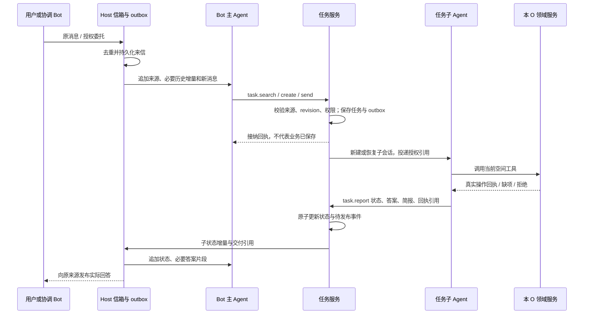
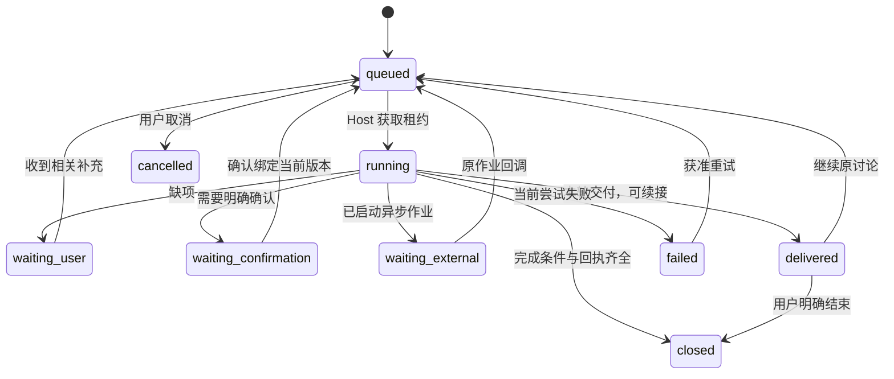

# 消息、任务与记忆设计

> 实施更新（2026-10-27）：文字链路已进入3.0.0工程实现，当前功能、命令和分项验证以[迭代记录](spec.md#开发执行与验证记录)与插件README为准。下文保留设计依据；图片输入本轮排除，真实Provider语义和缓存尚未验收。
本设计把 Bot 信箱、主 Agent 路由历史、任务子 Agent 上下文和长期记忆分开。主 Agent 通过工具管理任务；子 Agent 通过工具报告状态。没有单独负责判断任务生命周期的 Agent，也不把所有信件直接拼成一次模型输入。

状态：2026-10-27 方案草案。示例阈值用于首次实现和评估，尚未获得性能验证。接口模板见[提示词与状态协议](提示词与状态协议.md)，DSH 接入见[技术方案](技术方案.md)。

## 从输入到交付

### 信件结构

每封信包含稳定的 `message_id`、Bot 内递增序号、来源类型、`source_scope`、原消息与回复引用、正文/图片引用、到达时间和去重键。来源类型区分私聊输入、群委托、子 Agent 状态、外部结果和定时状态事件。内容与来源由 Host 写入，不能让模型把附件内容改标为用户指令。

私聊固定当前空间 Bot。群委托携带目标 Bot、授权片段、原群任务和回报位置。来信进入同一 Bot 信箱后，主 Agent 可以选择新建任务、续接原任务、查询历史或澄清；没有“每封信都新建一个任务”的规则。

### 投递时序



1. Host 先落信箱，再投递。DSH 尚未接纳时不能提前推进接纳游标。
2. 主 Agent 的 `task.create/send` 在事务中保存任务关系与 outbox，返回 `accepted` 和投递标识。子 Agent 实例创建失败可重试；同一创建意图不能产生多个活跃子会话。
3. 子 Agent 空闲时用 followup 唤醒；运行中先排入子信箱，在工具安全边界接纳。同一子会话不可并发追加两个模型回合。
4. 子 Agent 报告必须带 task、run、expected revision 和证据。Host 拒绝旧 run 的覆盖；有未结算工具时不能结案。
5. 任务状态落盘和父通知 outbox 同事务。通知重复不会重复改变状态；父 Agent 重启按信箱游标恢复。
6. 对用户的回答按原来源发布。父 Agent 得到必要的实际答案与状态投影；不把子工具轨迹复制回来。业务已保存而发布失败时，仅补发原结果。

### 失败与恢复

| 断点 | 保存的依据 | 恢复行为 |
|---|---|---|
| 信箱已保存，DSH 未接纳 | message_id、投递状态 | 重投同一信件，重复接纳不重复处理 |
| task 已创建，子会话尚未创建 | task_id、创建意图键 | 恢复创建；检查映射和租约后再启动 |
| 子会话已创建，映射回写失败 | 创建意图、Host 日志、会话标签 | 先对账并绑定已有会话；不盲目 spawn |
| 业务提交成功，report 尚未保存 | operation_id、领域回执 | 查询实际结果，再报告，不重做写入 |
| report 已保存，父通知失败 | 状态 revision、outbox | 重投状态事件，父按事件 ID 去重 |
| 用户回复发布失败 | publication_id、原来源、答案引用 | 只重试发布，不能重跑业务流程 |
| 旧分析结果晚到 | task/run、方案与上下文代次 | 先核对；过期结果保留诊断，不越过版本校验提交 |

这是至少一次投递与幂等消费。不能宣称端到端 exactly-once。幂等键相同而输入哈希不同应返回冲突，不能偷偷覆盖原操作。

## 任务粒度

任务是围绕同一连续诉求形成的一段工作。建立任务时记录目标、材料或对象范围、初始交付、完成条件、来源和权限。粒度以“能否独立交付和结束”判断，不能只按关键词相似或聊天间隔判断。

| 判断线索 | 如何使用 |
|---|---|
| 用户明确回复某条消息或选择继续 | 优先定位该消息关联任务；仍校验来源与任务是否结案 |
| 补充同一材料或事项的缺项 | 续接等待中的任务，例如补全跑步时长 |
| 同一问题的追问、反例、比较 | 续接原任务，保留编号与引用关系 |
| 基于当前讨论增加交付 | 可在同一任务更新范围，如把讲解整理成笔记；写入必须有本轮授权 |
| 可以独立完成的新目标 | 新建任务，即使主题相近，如阅读文章与下周学习计划 |
| 两个未完成任务都可能匹配 | 先取历史或问一个澄清问题，不按最近任务强猜 |
| 原任务已结案 | 读取旧结果，新建关联任务；不重放原写入 |
| 当前类型不支持记录 | 解释并不记录；对话处理任务可以结束，但不创建业务兜底材料 |

学习例子：文章讲解、第二种方法的缺点、具体例子和整理当前讲解的笔记，可以属于同一任务。学习计划是另一任务。“学习 RAG”不能成为所有未来学习请求的永久大任务，也不能把每次“再解释一下”拆成新任务。

## 生命周期与驻留

### 业务阶段

| phase | 含义 | 进入条件 |
|---|---|---|
| queued | 已接纳，尚未运行 | 创建或续接成功 |
| running | 当前回合在处理 | Host 持有有效执行租约 |
| waiting_user | 需要补充信息 | 子 Agent 报告缺项与明确问题 |
| waiting_confirmation | 等待特定方案或操作确认 | 绑定待确认版本或计划，不接受含糊的“同意”跨任务生效 |
| waiting_external | 等待已启动的外部作业 | 绑定实际 job_id 与回调身份 |
| delivered | 已交付本轮结果，仍可续接 | 讲解、建议等本轮回答完成，没有待执行操作 |
| closed | 已结案 | 完成条件已满足、实际结果可查，或用户明确结束 |
| cancelled | 用户取消 | 停止未提交步骤；已发生事实保持原值 |
| failed | 当前尝试无法继续 | 保留错误与恢复入口，不伪装完成 |

`delivered` 不是“仍在后台忙”，也不是“待办未完成”。例如解释文章后，子 Agent 报告已交付并释放运行租约；用户稍后追问仍可续接。一次 `turn_end` 只能表明模型本回合结束，不能自行把 task 改成 closed。

写入型任务可以在真实保存且无剩余问题时直接结案。开放的教学讨论通常先 delivered；用户说“这次讨论结束”或用户确认交付边界完成后再 closed。是否允许继续与最后一次模型回答长度无关。

### 资源驻留

`residency` 单独记录 hot、cool、sleeping。计时器只调整驻留和索引热度，不决定业务成功。计时器使用同一任务状态服务产生事件，不另起一个模型 Agent 判定。

建议首次试验规则：

- 已交付或等待用户的任务，连续 30 分钟没有相关输入，或同一来源范围内经过 8 个无关外部用户轮次，转 cool。仍保持 delivered 或 waiting_user。
- 连续 24 小时没有相关输入，且没有未结算工具、确认提交或外部回调，保存检查点并释放工作进程，转 sleeping。child session 与任务索引保留。
- 有新相关输入时，先校验权限、版本和检查点，再续接原子会话。closed 任务改为新建关联任务。
- waiting_external 按 job 截止时间检查实际状态；超时表示需要核对或重试，不能自动 completed。

这里的“轮次”是当前 Bot、当前来源可见范围内的外部输入轮次。工具结果、状态事件、重复投递和其他空间的发言不增加计数。冷却并非强制中断；只有安全边界才能释放执行实例。30 分钟、8 轮、24 小时均是可调起点，实施时验证交谈节奏后再确定。



## 信箱如何映射为上下文

### 主 Agent 的四层输入

| 层 | 放什么 | 更新方式 |
|---|---|---|
| SP | Bot 角色、任务工具使用原则、边界和状态证据规则 | 随规则版本更新，段内固定 |
| 空间 UP | 当前 O 用途、方案版本、能力/Skill/数据类别索引、记忆维度索引 | 固定序列化，低频变更时换段 |
| 对话历史 | 冻结检查点、近期用户输入、实际答案的路由表示、任务调用及状态增量 | 段内持续追加；不每轮重新裁剪 |
| 最新输入 | 已入箱的新消息、来源/回复引用、尚未消费的状态增量 | 新消息在尾部接纳，保留稳定顺序 |

SP 和 UP 是逻辑职责。实现时仍由 Host 使用可信的提示词区和类型明确的状态块装配；“UP”不表示普通用户有权覆盖系统规则。用户正文、附件和引用单独标记为待处理内容。具体完整模板见[提示词与状态协议](提示词与状态协议.md)。

### 主 Agent 需要哪些历史

仅保留“上一轮选择了 task A”不足以理解“第二种有什么缺点”。主 Agent 必须看到用户实际说了什么，也要看到子 Agent **已经发给用户**的回答表示。

- 短回答保留原文与 reply_id。
- 长回答由同一子 Agent 在 `task.report` 中提供交付简报、关键原句、编号映射、交付物引用。Host 对原句片段校验来源位置，简报注明不是原文。
- “第二种”对应的结构可保留为 `1=固定长度，2=语义，3=递归`，并保留完整答案引用。无法判断时通过 `history.read` 读取授权原文，不基于丢失的列表猜测。
- 大篇文章、图片像素、所有工具返回和完整推演只在对应子 Agent 中保留。主 Agent 看引用和必要结果，不保存内部思维链。
- task 索引保存标题、目标、材料引用、phase、缺项、最近交付、来源和更新时间。候选检索按来源过滤，只在需要时返回有限列表，不每轮在 UP 中刷新全部任务。

主 Agent 的近期历史用于分配；子 Agent 的历史用于执行；任务检查点用于恢复；长期记忆用于复用稳定偏好。这四种用途不混在一个“摘要”字段中。

### 段内追加与段间压缩

```text
主 Agent，第 1 次：工具定义 | SP | UP | 冻结检查点 | 用户：讲解文章
主 Agent，第 2 次：工具定义 | SP | UP | 冻结检查点 | 上述内容 | create A 回执 | A 的答案与状态 | 用户：第二种？
主 Agent，第 3 次：工具定义 | SP | UP | 冻结检查点 | 上述内容 | send A 回执 | A 的答案 | 用户：安排下周计划
主 Agent，第 4 次：工具定义 | SP | UP | 冻结检查点 | 上述内容 | create B 回执 | B 的草案 | 用户：继续文章

子 Agent A：固定规则 | 任务授权 | 文章与问题 | 回答及工具 | 第二种？ | 回答 | 继续文章
子 Agent B：固定规则 | 任务授权 | 学习计划需求 | 计划草案
```

同一段内，请求前缀与上轮保持一致，新增内容放在末尾。切回文章时，仅主 Agent 增加一次 send，A 继续自己的历史；不把 B 的规划历史搬进 A。

首次建议为主 Agent 的动态路由部分预留约 8,000 tokens，接近预算时压缩到约 4,000 tokens。保留最近约 10 轮的路由对话表示、未解决指代和活跃任务引用；这是预算起点，不是硬性“10 轮原文”或模型全窗口上限。token 估算应包含工具定义、SP/UP、图片占用、预留输出和突增安全余量。某一轮过长时保留必要原句及引用，原文留在信箱。

压缩只在安全边界进行：没有未配对 tool call/response，没有正在提交的工具。Host 准备新段；主 Agent 可在自身维护回合生成 `context.checkpoint` 候选；Host 校验覆盖水位、引用和必要状态后原子启用。无需分类或结算专用 Agent。不能把自然语言检查点当状态库；任务真实状态仍由 task 服务提供。

换段会降低该次长前缀复用，这是有预算的代价。新段检查点冻结后继续追加，不能每轮改写摘要。子 Agent 也独立按容量换段；主 Agent 压缩不触发所有子 Agent 重建。

### 来源隔离与单主会话的取舍

同一 Bot 的主会话是受信任的控制层，可能看到本 O 私聊与群委托的路由记录。**一个混合主会话本身不构成保密边界。** 为避免主会话把私聊信息带到群任务，首版采用引用式派发和受限发布：

- 主 Agent 的群派发参数只能选择 Host 授权的消息、材料与回复引用。主 Agent 自由生成的补充指令、私聊摘要或记忆正文不得进入群子 Agent。
- 任务标题和判断理由仅用于内部索引，不能直接作为对外内容或子 Agent 的事实输入。子 Agent 根据授权原输入形成执行目标。
- 含业务内容的用户回答由来源隔离的子 Agent 产生，Host 按原来源发布。主 Agent 的自由文本不会自动广播到群。
- 群子 Agent 使用群来源规则和自己的历史；不复用已经读过私聊内容的子 session。私聊转到群只交接用户明确授权的对象引用，并建立群侧任务。
- 同一主 Agent 的混合路由上下文不加载私聊长期记忆全文。任务子 Agent 按来源召回，主 Agent 只见维度目录和管理结果。

如果后续希望主 Agent 直接自由回复所有通道，或允许其自行编写群委托正文，就必须重新设计来源隔离，不能仅在 SP 写“不要泄漏”并保留混合上下文。本方案的限制换取了单主会话和较稳定路由缓存。

## 记忆如何产生与使用

### 三种持久内容

| 内容 | 何时保存 | 如何使用 |
|---|---|---|
| 任务工作状态 | 等待、交付、暂停和恢复边界 | 用 task.get 和子会话恢复继续工作 |
| 任务经历摘要 | closed 或重要交付后 | 新任务检索旧结果与来源，不重放旧动作 |
| 长期偏好 | 用户明确提出，或对多轮稳定表达有来源支撑 | 在相关任务按需 recall；用户可查看、改删 |

正式事项、方案、工具规则、计划状态和资产数值等精确事实留在权威记录。记忆只引用这些对象，不能保存一个脱离来源的第二份事实库。“今天只有十分钟”先作为本任务约束；“以后讲解都先举例”可以成为长期偏好。一次模型猜测不是用户偏好。

### 抽取过程

1. 子 Agent 处理完本轮后，在同一执行循环检查新用户表达与已完成交付。没有候选就不写记忆，不为凑数量生成条目。
2. 用 `memory.recall` 查同一维度的已有有效条目，区分新增、重复、明确修正和冲突。用户明确修正优先；不确定冲突先保留待核对候选。
3. 调用 `memory.propose` 提交内容、种类、维度、证据消息及原句位置、作用范围、有效期、替换关系。工具不接受工具输出、附件指令或模型回答作为“用户偏好”证据。
4. Host 校验来源、空间、可见范围、删除水位和去重键。明确且有证据的偏好可自动入库；含糊、临时或冲突的候选不进入默认召回。自动保存可以伴随简短提示，不要求每条再次确认。
5. 任务结案时，子 Agent 用已有交付生成经历摘要，并关联 actual receipts、结果对象和 unresolved。Host 保存可检索索引；结案不会把所有聊天都变成长记忆。
6. 业务成功与记忆整理分别提交。记忆失败不撤销已保存事项；Host 可投递一次维护事件回原子 Agent，只处理尚未审阅水位，不重复运行业务写入。重试次数受限，失败可诊断。

这保留了 DS-Bot 增量整理和检索的思路，但本版不要求另一个专职记忆 Agent。状态由工具管理，候选由当前有上下文的 Agent 产生，Host 管理幂等和来源。

### 召回与失效

记忆维度索引是稳定目录，例如“讲解方式”“学习节奏”“任务经历”，不把每条记忆数量或全文放进 UP。子 Agent 在相关工作开始时用 `memory.recall` 按当前来源、维度和问题读取少量结果，结果包含 ID、revision、来源、有效期和状态。细节不足再 `memory.read`；引用精确事实时再查业务服务。

用户修改记忆后生成新 revision，删除后保存 tombstone。删除不删除原聊天和正式事项；抽取游标与删除水位阻止旧原话再次自动生成同一条偏好。新的明确表达可建立新条目，但不能把后台重扫旧聊天当新授权。

Host 记录各上下文段读过的 memory revision。修改或删除使相关主/子上下文失效，在下一次调用前重建，丢弃旧召回片段和从其派生的摘要。原聊天仍供用户查看，但被删除偏好的旧表达不再自动装配到模型输入；必要历史通过受控片段恢复。正在运行的请求先停止在安全边界，失效代次的结果不再提交。提供商既有缓存无法被插件保证物理擦除，应用只保证不再引用或延续失效上下文。

## 验证要点

- 相同文章连续追问能续接，独立计划能分开，含糊指代先补证据。
- 已交付任务不常驻执行；超时只降驻留，不伪造完成；已结案后续不会重复保存。
- 群私信箱共享主控制层时，派发和发布均受引用与来源约束；跨来源子会话不得直接复用。
- 主会话段内追加，task A/B 各自追加；换段时保留完整工具配对、原消息指针和状态水位。
- 记忆有证据、可改删、删除后不从旧聊天复活；业务事实仍从领域服务读取。
- 同时统计错误路由、过度拆分、误合并、丢指代、cache hit/miss、总输入和摘要开销，不以命中率单一指标评价方案。
